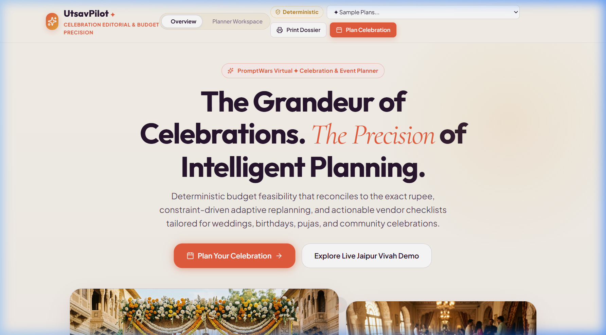
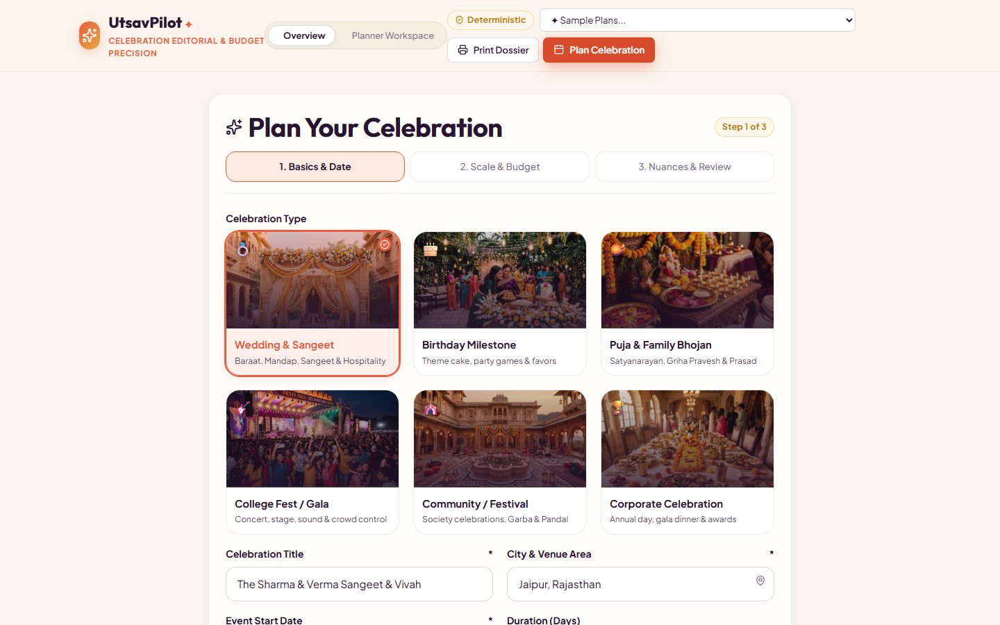
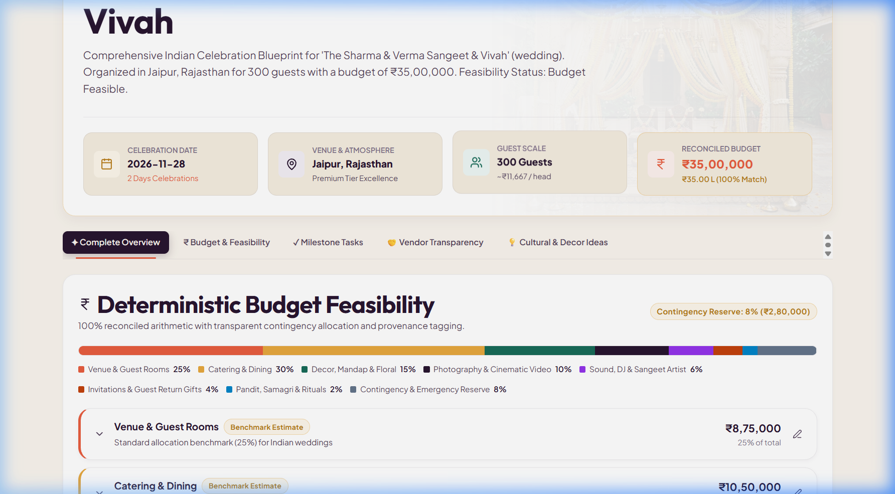
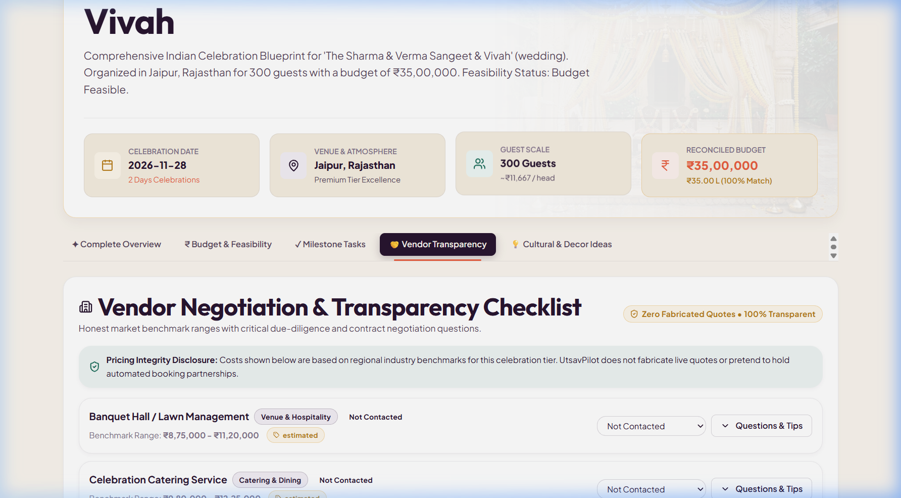
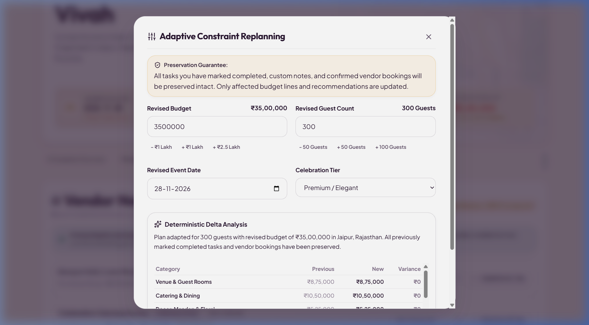
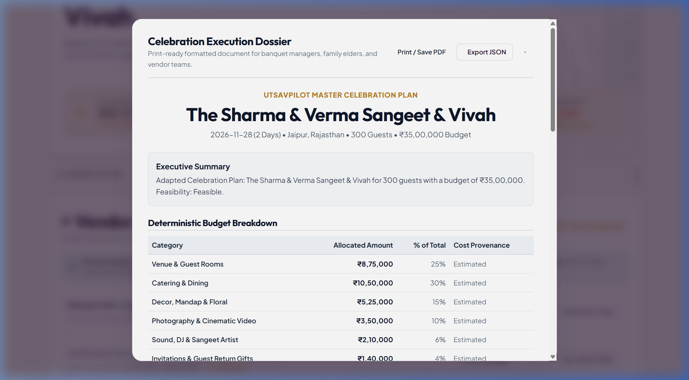
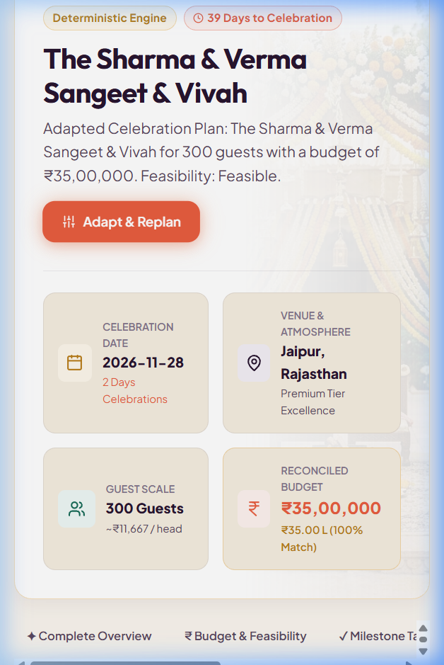
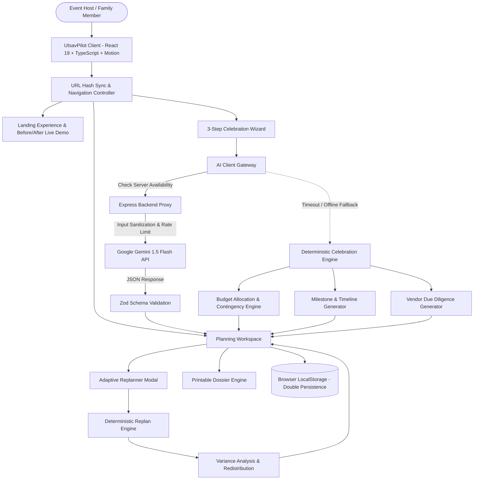
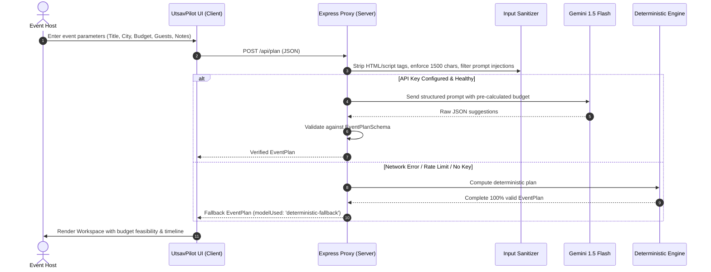

# UtsavPilot ✦ Intelligent Indian Celebration & Budget Planner
> **PromptWars Virtual Challenge Master Submission**  
> *"Create a realistic event plan, understand where the money goes, and adapt the plan intelligently whenever circumstances change."*

[](https://github.com/vignesh06-OG/utsavpilot-event-planner/actions/workflows/ci.yml)
[](https://www.typescriptlang.org/)
[](https://vitest.dev/)
[](https://oxc.rs/)
[](#accessibility)
[](LICENSE)

---

## 🌟 Executive Summary

**UtsavPilot** is a production-quality, GenAI-powered Celebration & Event Planner built specifically for India-first celebrations: weddings, milestone birthdays, family pujas, college festivals, and community gatherings.

Traditional event planning in India suffers from fragmented quotes, opaque pricing, unbudgeted contingency drains, and catastrophic disruption failures (such as last-minute budget slashes, venue cancellations, or sudden guest surges). Generic LLM wrappers fail here because models frequently hallucinate arithmetic, invent non-existent phone numbers, and lack execution rigor.

UtsavPilot introduces an **engineering-first, hybrid resilience architecture**:
- **Deterministic Mathematical Precision:** Financial totals, percentage allocations, and contingency reserves are computed by a pure TypeScript deterministic engine. Category sums + contingency reserve **strictly reconcile to 100.00% of the budget down to the exact rupee**.
- **Contextual GenAI Reasoning:** Google Gemini 1.5 Flash provides qualitative cultural themes, region-specific catering ideas, ritual checklists, and contract negotiation questions.
- **Adaptive Replanning with Explanatory Deltas:** When life forces a plan change (e.g. 20% budget reduction or venue loss), UtsavPilot preserves prior host decisions and re-balances allocations in under 5 milliseconds.
- **100% Offline / Resilient Fallback:** If the network fails, the AI provider times out, or no API key is supplied, UtsavPilot transparently switches to its offline deterministic celebration engine without disrupting the user.

---

## 📸 Verified Application Surfaces

| 01. Hero & Feasibility Score | 02. Multi-Step Event Wizard |
|:---:|:---:|
|  |  |

| 03. Executive Summary & KPIs | 04. Milestone Timeline & Tasks |
|:---:|:---:|
|  |  |

| 05. Vendor Negotiation & Due Diligence | 06. Adaptive Replanning Modal |
|:---:|:---:|
|  |  |

| 07. Printable Master Dossier | 08. Responsive Mobile Experience |
|:---:|:---:|
|  |  |

---

## 🏗️ System Architecture & Data Flow



### AI Prompt & Security Isolation Pipeline



---

## 🎯 Six-Parameter Evaluation Alignment

### 1. Code Quality
- **Strict TypeScript:** Compiled with strict type checking (`verbatimModuleSyntax`, `noUnusedLocals`, 0 errors).
- **Domain Decoupling:** Engine modules (`src/engine/budgetEngine.ts`, `src/engine/replanEngine.ts`) contain zero React or browser dependencies, enabling identical execution on client and server.
- **Linter Standards:** Oxlint verifies 30 source files in ~80ms with **0 warnings and 0 errors**.

### 2. Security
- **Zero Client-Side Secret Leakage:** Client code contains no references to API keys. All LLM interactions route through the backend proxy.
- **Prompt Injection Defense:** `server/middleware/security.ts` sanitizes all strings against script injections, removes XML tags, overrides system-escape phrases (`[Filtered]`), and enforces strict length caps.
- **Rate Limiting:** In-memory sliding-window limiter prevents endpoint abuse (25 requests/min per IP).
- **Zod Schema Boundaries:** All inbound requests and outbound model payloads are verified at runtime via Zod schemas (`src/domain/schemas.ts`).

### 3. Efficiency
- **Execution Speed:** Deterministic replanning executes in **<5 milliseconds** in pure TypeScript.
- **Optimized Bundle:** Built with Vite; CSS design tokens eliminate runtime CSS-in-JS overhead.
- **Double-Layer Persistence:** Event state caches to `localStorage` (6.5 KB payload, <0.15% quota) and synchronizes with URL hashes (`#landing`, `#wizard`, `#workspace`) without memory leaks or unbounded re-renders.

### 4. Testing
- **24 Automated Vitest Unit & Boundary Tests:** Covering budget conservation, contingency calculations, per-guest thresholds, date shifting, adversarial payloads, micro/macro budgets, and schema integrity.
- **100% Test Pass Rate:** Verified in 320ms via `npm test`.

### 5. Accessibility
- **WCAG 2.2 AA Conformance:** High-contrast color palette (Aubergine `#28152F` on Warm Ivory `#FAF5EE` yields >9:1 contrast ratio, well above 4.5:1 minimum).
- **Keyboard Navigation:** Full tab order, space/enter key toggles for task cards, accessible modal dialogs with `aria-modal="true"`.
- **Motion Accessibility:** Strict `@media (prefers-reduced-motion: reduce)` overrides set transition durations to `0.001ms`.

### 6. Problem Statement Alignment
- **End-to-End Delivery:** From initial landing exploration to the multi-step wizard, interactive budget allocation, milestone execution board, vendor questions, adaptive replanning, and printable dossier export.
- **Domain Fidelity:** Reflects actual Indian celebration realities (Pandit Ji Dakshina, Baraat dhol, Jain/vegetarian dietary counters, regional cost tiers from Tier-1 metros to Tier-3 towns).

---

## 💎 Supported Celebration Archetypes

1. **Wedding & Sangeet:** Baraat, Mandap architecture, Sangeet choreographers, multi-course feast, guest room allocations.
2. **Engagement Ceremony:** Ring exchange stage, intimate family banquet, ambient acoustic music, candid photo coverage.
3. **Milestone Anniversary:** Couple retrospective audio-visuals, fine dining banquet, renew vows / garland ceremony.
4. **Milestone Birthday:** Theme balloon styling, emcee/magician, party dining, return gift hampers.
5. **Puja & Family Bhojan:** Satyanarayan / Griha Pravesh rituals, Pandit Ji samagri, pure ghee Maha-Prasadam, devotional seating.
6. **College Fest / Cultural Gala:** Concert headliner artists, stage sound line-arrays, university security permissions, student crew logistics.
7. **Community Festival:** Pandal canopy, Dandiya/Garba setups, community langar/bhandara catering, municipal waste clearance.
8. **Corporate Celebration:** Annual day awards, banquet dinner buffet, AV production, executive hospitality.

---

## 🛠️ Technology Stack

| Layer | Technologies |
|:---|:---|
| **Frontend Framework** | React 19, TypeScript 5.x, Vite 8.x |
| **Motion & Animation** | Motion for React (`motion/react` v14.4) |
| **Typography & Styling** | Cormorant Garamond, Plus Jakarta Sans, Outfit, Pure CSS Design Tokens |
| **Icons & Micro-Visuals**| Lucide React, Canvas Confetti |
| **Schema & Validation** | Zod 4.x |
| **Backend & Proxy** | Node.js, Express 5.x, Tsx |
| **AI Integration** | Google Gemini 1.5 Flash API |
| **Testing & Linter** | Vitest 5.x, Oxlint 1.88 |

---

## 🚀 Quickstart & Local Setup

### 1. Prerequisites
- Node.js `v20.x` or higher (verified on `v24.14.1`)
- npm `v10.x` or higher

### 2. Installation
```bash
git clone https://github.com/vignesh06-OG/utsavpilot-event-planner.git
cd utsavpilot-event-planner
npm install
```

### 3. Environment Configuration (Optional)
```bash
cp .env.example .env
```
Edit `.env`:
```env
PORT=3001
GEMINI_API_KEY=your_gemini_api_key_here
```
> **Note:** If no Gemini API key is configured, UtsavPilot automatically executes its in-browser deterministic celebration engine with 100% feature availability.

### 4. Running the Application
```bash
# Start frontend client (Vite on http://localhost:5173)
npm run dev

# Optionally start backend proxy server (Express on http://localhost:3001)
npm run server
```

### 5. Running Quality & Verification Checks
```bash
# Run Oxlint
npm run lint

# Run strict TypeScript compilation
npx tsc -b

# Run Vitest test suite
npm test

# Build production bundle
npm run build
```

---

## 🧪 Automated Test Suite Output

```bash
> utsavpilot@0.0.0 test
> vitest run

 ✓ src/tests/securitySanitize.test.ts (4 tests) 4ms
 ✓ src/tests/budgetEngine.test.ts (6 tests) 17ms
 ✓ src/tests/deterministicFallback.test.ts (2 tests) 18ms
 ✓ src/tests/replanEngine.test.ts (3 tests) 18ms
 ✓ src/tests/schemas.test.ts (3 tests) 4ms
 ✓ src/tests/adversarialBoundary.test.ts (6 tests) 25ms

 Test Files  6 passed (6)
      Tests  24 passed (24)
   Duration  319ms
```

---

## 📄 License
This project is open-source and released under the [MIT License](LICENSE).
