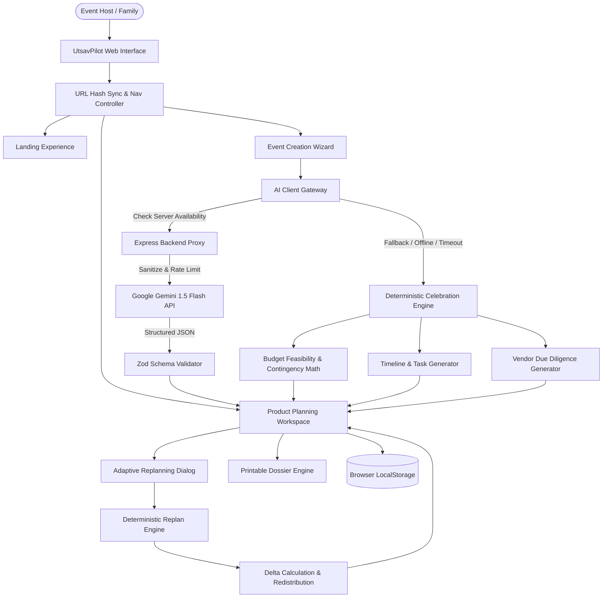

# UTSAVPILOT — MASTER IMPLEMENTATION PLAN
**Challenge Track:** PromptWars Virtual Competition Submission  
**Target Submission Standard:** Defensible, Verified, Production-Quality  
**Author:** Senior Product Engineering & Architecture Team  
**Revision:** 1.0.0  

---

## 1. System Architecture Overview

UtsavPilot is engineered as a **hybrid resilience architecture**:
- **Presentation Layer (React 19 + TypeScript + Motion):** Component-based, responsive UI designed around the editorial identity *"Celebration Editorial meets Intelligent Planning"*.
- **Domain & Calculation Engine (Pure TypeScript):** Independent deterministic mathematical modules (`budgetEngine.ts`, `replanEngine.ts`, `deterministicFallback.ts`) that execute both in-browser and server-side without external dependencies.
- **Validation & Schema Layer (Zod):** Strict schema boundaries validating all inputs, event plans, replan deltas, and AI outputs.
- **Backend & Proxy Layer (Node.js + Express):** Stateless API proxy isolating LLM provider calls, enforcing rate limits (sliding window), sanitizing inputs against prompt injection, and returning structured plans.
- **Persistence Layer (Browser LocalStorage + URL State):** Multi-layer state caching preserving user plans across page reloads and browser back/forward navigation.

---

## 2. Phased Engineering & Verification Roadmap

### Phase 0: Requirements Discovery & Baseline Audit (Complete)
- [x] Inspect existing workspace, files, and git history.
- [x] Verify toolchain (`node v24.14.1`, `npm 11.11.0`, `vite 8.3.4`, `vitest 5.0.5`, `oxlint 1.88.0`).
- [x] Verify 18/18 baseline Vitest unit tests passing.
- [x] Produce `docs/COMPETITION_REQUIREMENTS.md`.
- [x] Produce `docs/IMPLEMENTATION_PLAN.md`.
- [x] Produce `docs/RISK_REGISTER.md`.
- [x] Produce `docs/TRACEABILITY_MATRIX.md`.

### Phase 1: Toolchain Audit & Environment Discovery (Complete)
- [x] Check extension environment (confirmed: Roo Code, CodeRabbit, and Ralph Loop are not pre-installed in this environment; documented limitation honestly).
- [x] Check Git credential environment (confirmed: Git Credential Manager active with `vignesh06-OG`).
- [x] Configure `.coderabbit.yaml` for repository-level CodeRabbit reviews upon publication.

### Phase 2: Core Engineering & Product Defensibility
- [x] Verify domain calculations in `budgetEngine.ts` and `replanEngine.ts`.
- [ ] Add expanded test cases to `src/tests/` covering adversarial edge cases:
  - Zero, negative, and extreme budget allocations
  - Boundary conditions on regional cost-per-guest thresholds
  - Replan calculations with zero contingency remaining
  - Deep XSS and script payload sanitization
- [ ] Verify error boundaries and fallback displays across all workspace views.

### Phase 3: Premium UI & Motion System Verification
- [x] Motion system implemented via `src/motion/motionTokens.ts` using `motion/react`.
- [x] Initial page load sequences on hero, headline, floating feasibility cards.
- [x] View transitions wrapped in `<AnimatePresence mode="wait">`.
- [x] Scroll reveals using `whileInView` across all below-the-fold sections.
- [x] Micro-interactions on buttons, checkboxes, cards, and accordions.
- [x] Strict `@media (prefers-reduced-motion: reduce)` compliance.
- [ ] Execute real browser QA loop across 5 distinct viewports (1440x900, 1280x800, 768x1024, 390x844, 360x740).

### Phase 4: Six Evaluation Parameters Hardening
1. **Code Quality:** Strict TypeScript typing, zero unused imports, clean module architecture, Oxlint compliance.
2. **Security:** Review client/server boundary, input sanitization, safe rendering, CORS configuration.
3. **Efficiency:** Audit production bundle size, eliminate code bloat, verify execution times.
4. **Testing:** Expand unit and integration test suite beyond 18 baseline tests to achieve robust boundary coverage.
5. **Accessibility:** Audit keyboard tab orders, ARIA attributes, semantic tags, and screen-reader announcements.
6. **Problem Statement Alignment:** Validate complete traceability from prompt requirements to delivered features.

### Phase 5: Adversarial Red Team Evaluation
- Conduct 5-perspective independent review:
  1. Technical Evaluator (Code fragility & overengineering)
  2. Security Auditor (Threat modeling & injection risks)
  3. Product Evaluator (Real-world domain utility vs generic wrappers)
  4. Accessibility & UX Specialist (WCAG barriers & usability snags)
  5. Competition Judge (Scoring justification & fatal flaw detection)
- Compile findings into `docs/FINAL_RED_TEAM_REVIEW.md`.

### Phase 6: End-to-End Real Browser Verification
- Start local application and test complete user journeys:
  - Landing → Event Wizard → Workspace → Replan Modal → Task Board → Print Dossier.
  - Test browser Back/Forward navigation with state persistence.
  - Capture real screenshots for documentation.

### Phase 7: Public GitHub Repository Packaging
- Create clean, professional public repository on GitHub (`vignesh06-OG/utsavpilot-event-planner`).
- Craft comprehensive, publication-grade `README.md` with system diagrams, features, quality metrics, and screenshots.
- Configure GitHub Actions CI workflow (`.github/workflows/ci.yml`).
- Include `LICENSE` (MIT), `CONTRIBUTING.md`, `SECURITY.md`, and `.env.example`.

### Phase 8: Deployment & Public Verification
- Build and verify production artifacts.
- Deploy to high-availability static/edge hosting (e.g. Vercel / Cloudflare Pages / GitHub Pages).
- Verify public URL and ensure production behavior matches local verification.

### Phase 9 & 10: Final Sign-off & Submission Package
- Assemble `SUBMISSION_PACKAGE.md` and `docs/FINAL_EVALUATION_SCORECARD.md`.
- Verify all gate criteria before declaring completion.
